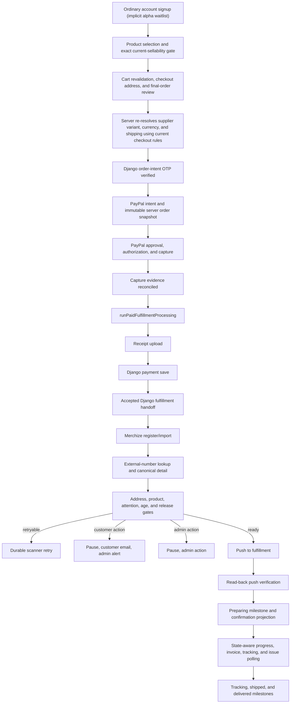

# Shop Alpha Order Flow Release Guide

Last updated: 2026-10-27

Status: **CANONICAL RELEASE PLAN**

This guide is the release-level source of truth for getting the Codex Christi shop from the current
implementation checkpoint to a public alpha in which a real customer can sign up, pay, receive clear
order confirmation, enter fulfillment safely, receive lifecycle updates, and be supported without
payment or provider side effects being replayed.

Every completed Codex Christi account signup is treated as joining the alpha waitlist. "Waitlist" is
a rollout label, not a separate persisted participation state: there is no additional enrollment
record, acknowledgement checkbox, approval step, or user-linking workflow.

The domain guides remain authoritative for their detailed contracts:

- `PAYPAL_TX_LEDGER_GUIDE.md`
- `PAYPAL_WEBHOOK_REGISTRATION_AND_RECOVERY_GUIDE.md`
- `MERCHIZE_FULFILLMENT_OPS_GUIDE.md`
- `ADMIN_RECOVERY_TOOLING_GUIDE.md`
- `SHOP_CHECKOUT_RECOVERY_IMPLEMENTATION_GUIDE.md`

When a domain guide contains an older "next", "imminent", or open-decision section, the priority and
resolved product decisions in this guide take precedence.

---

## 1. Alpha Outcome

The first alpha is public to anyone who completes the ordinary account signup. It is not an
invitation-only buyer program. Preserve the core registration → OTP → login structure. Incremental
auth improvements may be scoped independently, including their own migrations when justified, but
must not be introduced as a waitlist/participation subsystem or divert the release from the
customer-order path. The experience must make alpha status visible without turning signup or
checkout into a test harness:

- a concise, non-blocking alpha notice on the shop homepage;
- a concise, non-blocking alpha notice on the ordinary signup page;
- no admin approval requirement merely to shop;
- no separate alpha checkbox, versioned acknowledgement, participation store, or waitlist
  persistence;
- no test language inside normal payment, fulfillment, or order-status copy;
- no provider jargon exposed to customers.

Alpha is release-ready only when all of the following are true:

1. The server, not the browser cart, owns the amount and line items sent to PayPal.
2. A successful PayPal capture can never be replayed by recovery.
3. An accepted Django fulfillment handoff can never trigger payment-side replay.
4. Every provider push is gated, idempotent, auditable, and verified.
5. Invalid or mismatched addresses stop before push and notify the correct people.
6. Non-US addresses continue without bulk admin intervention when exact provider read-back matches.
7. Customers can securely reopen confirmation across devices.
8. Customers receive the six owned lifecycle messages defined in this guide.
9. Admin can identify the failed stage, data target, customer communication state, and safe next
   action.
10. A scheduled worker can recover transient work and proves that it is healthy.
11. One controlled live order completes from checkout through verified fulfillment and lifecycle
    reconciliation without duplicate payment, duplicate import, or duplicate customer email.

---

## 2. Resolved Product And Architecture Decisions

| Area                    | Alpha decision                                                                                                                                                                                                                                                                                                                                                                                                                             |
| ----------------------- | ------------------------------------------------------------------------------------------------------------------------------------------------------------------------------------------------------------------------------------------------------------------------------------------------------------------------------------------------------------------------------------------------------------------------------------------ |
| Participation           | Every completed ordinary account signup is implicitly part of the alpha waitlist. Do not add a separate enrollment record, acknowledgement, user-linking flow, or invite approval gate.                                                                                                                                                                                                                                                    |
| Alpha disclosure        | Use small informational notices on the signup page and shop homepage. They do not block signup, require dismissal, or create persisted state.                                                                                                                                                                                                                                                                                              |
| Auth evolution          | Preserve the core signup → OTP → login contract. Independently justified auth enhancements are allowed, but they must not be coupled to alpha participation or replace the order-flow priority.                                                                                                                                                                                                                                            |
| Catalog eligibility     | Do not create an arbitrary small hardcoded allowlist. A storefront `all-variants` row proves identity only, not current sellability. A variant may be offered only after exact, unambiguous reconciliation to the current product-line/catalog source, live server price, and current shipping calculation. Storefront and supplier SKU namespaces remain separate. This is an order-integrity check, not a new destination or tax policy. |
| Currency behavior       | Preserve the existing multi-currency checkout and PayPal behavior. P0.2 records the exact server-resolved currency and amounts used for an order; it does not restrict the alpha to USD.                                                                                                                                                                                                                                                   |
| PayPal tax capability   | The current PayPal setup does not provide tax-charging capability. The alpha must not calculate, add, collect, or pass a tax amount or tax line to PayPal.                                                                                                                                                                                                                                                                                 |
| Django scope            | Keep Django at its current boundary: order-intent verification, payment save, and initial Merchize order preparation/handoff. New address, contact, confirmation-access, notification, and lifecycle work is Next.js-owned.                                                                                                                                                                                                                |
| US addresses            | Merchize `valid` plus exact buyer-details read-back may continue automatically. Explicit invalid states stop before push.                                                                                                                                                                                                                                                                                                                  |
| Non-US addresses        | Merchize US validation does not apply. Provider `other`/`others` plus exact buyer-details read-back may continue automatically, labeled "not provider-validated." No routine admin batch approval is required.                                                                                                                                                                                                                             |
| Customer responsibility | Require a clear pre-payment review of address, size, variant, and quantity. Record a versioned acknowledgement. Do not claim that customer acknowledgement removes statutory rights.                                                                                                                                                                                                                                                       |
| Provider push           | `MERCHIZE_FULFILLMENT_PUSH_ENABLED` must be explicitly configured. Missing or invalid configuration fails closed. Every eligible order must eventually be pushed and verified.                                                                                                                                                                                                                                                             |
| Immediate processing    | Keep the capture-route `after(...)` continuation as the fast first-party trigger when explicitly enabled. Treat it as opportunistic, not durable.                                                                                                                                                                                                                                                                                          |
| Durable recovery        | Keep the scheduled PayPal recovery scanner and lifecycle scanner as the durable fallback. The confirmation status route stays read-only.                                                                                                                                                                                                                                                                                                   |
| PayPal webhooks         | Keep the existing verified PayPal webhook path as a payment-event safety net. This is separate from Merchize webhooks.                                                                                                                                                                                                                                                                                                                     |
| Merchize webhooks       | P1. The first alpha uses synchronous reads plus scheduled polling. Webhooks later accelerate the same durable milestone projection.                                                                                                                                                                                                                                                                                                        |
| Customer email owner    | Codex Christi owns customer order emails. Do not depend on or duplicate unconfirmed Merchize buyer emails.                                                                                                                                                                                                                                                                                                                                 |
| Customer milestones     | Payment received, address action required, preparing, tracking available, shipped, and delivered.                                                                                                                                                                                                                                                                                                                                          |
| Guest confirmation      | Use an emailed, purpose-bound, long-lived viewing capability. Authenticated access also requires matching `userId`. Expiry uses email OTP to issue a new capability.                                                                                                                                                                                                                                                                       |
| Destination scope       | P0.2 does not add, remove, or redefine supported destinations. Preserve current checkout behavior. Any later destination-policy change requires separate product direction and implementation scope.                                                                                                                                                                                                                                       |
| Worldwide scope         | Keep the storefront's current destination coverage during canonical-snapshot work. Missing SKU or reproducible shipping data may stop an individual order as a data-integrity failure, but P0.2 must not invent a geographic block.                                                                                                                                                                                                        |
| Broad provider controls | Refunds, disputes, automatic cancellation, product replacement, arbitrary artwork mutation, and full dashboard parity remain outside alpha scope.                                                                                                                                                                                                                                                                                          |

### What "validated catalog" means

It does not mean choosing a tiny list by hand. Merchize can continue returning storefront variants
after their corresponding supplier variant has been removed. A fresh live comparison confirmed
that behavior, so membership in the storefront `all-variants` response is only identity evidence.
It is not positive availability evidence.

The server must prove all of this for the selected variant:

- the product and variant are active;
- the storefront product ID, variant ID, storefront SKU, title, and options resolve as seller-store
  identity without being treated as supplier identity;
- when the storefront variant has a `Product` option, its product-line name plus the complete
  normalized non-Product option map resolves to exactly one variant in the current product-line
  response; that result owns the supplier product/variant identity and supplier SKU;
- when the storefront variant has no `Product` option, the supplier-facing SKU used by that path is
  an exact member of fresh, complete product-scoped supplier evidence, not a partial page or stale
  local snapshot;
- storefront and supplier SKUs are kept in separate fields/namespaces. They may differ and must not
  be equated, copied over one another, or used as an implicit fallback;
- missing, ambiguous, fuzzy/nearest-option, incomplete, or unverified reconciliation fails closed;
- the quantity is valid;
- the current server price is available in the checkout currency under the existing multi-currency
  behavior;
- the current shipping calculation can be reproduced from trusted supplier-SKU/catalog data without an
  unsafe flat fallback;
- the checkout snapshot can be reproduced later for receipt and fulfillment reconciliation.

Current-sellability verification gates public purchase controls, checkout entry, direct checkout,
and PayPal intent creation. Cart commands can save known selections and quantities offline;
the cart UI disables increases for a confirmed unavailable row, while an unverified row can still
be edited. Saving a cart does not prove sellability. Individual compatibility provider reads have
a 15-second timeout. The admin delivery
stream has a separate two-minute caller deadline; shared reads may continue for another customer.
This does not introduce an aggregate deadline for every customer lookup. A timed-out, failed, or incomplete provider
read is `unverified`, never positive availability evidence. A stale cart row remains visible so the
customer can remove it or reduce its quantity; unavailable/unverified rows block checkout and are
never silently substituted or deferred for post-payment adjustment. See the
[cart contract](../src/lib/cart/README.md).

Sellability and canonical-order reads for the base product and `all-variants` are strict `no-store`
provider reads. Retail prices come from that same complete variants response, not the paginated
`variants/search` endpoint. The durable storefront snapshot is display fallback only and never
positive availability evidence. Exact current product-line IDs and SKU must match fresh supplier
product evidence in SQLite. Expired or missing evidence is renewed inline with a bounded
`GET /product/catalog?search=<product SKU prefix>` lookup; a full variant SKU is not a supported
catalog search. Full-catalog generation age no longer blocks individual products. Complete scoped
responses replace their SKU links atomically; incomplete responses never prove removal or availability.
The default evidence TTL is 48 hours (`MERCHIZE_CATALOG_CURRENT_MAX_AGE_HOURS`). Requests share scoped
queries, with bounded concurrency, deadlines, and a short failure cooldown. No cron or `after()` is
needed. A cache write failure may use validated live evidence for that request, never stale proof.
Country-specific supplier shipping bands retain `to_country`; conflicting rates fail closed.

Only confirmed drift or unavailability from complete current evidence creates or updates a
per-variant catalog-data-health incident. Its evidence includes the storefront product/variant IDs,
title, storefront SKU, complete selected options and `Product` option when present, attempted current
supplier mapping/IDs/SKU, failure reason, source/generation timestamps, occurrence count, first/last
seen, and the safe manual action: update the storefront variant to a current product-line item or
remove it. Transient provider failures, timeouts, and incomplete or otherwise unverified evidence
remain aggregate operational health and must not fan out into per-variant incidents or one email per
customer attempt. Confirmed incidents accumulate in the persistent Storefront Data Health admin
queue. P0.2 does not add a catalog email/outbox path; outbound escalation belongs to the separately
scoped notification phase if it is later required.

`/admin/shop/storefront-data-health` is labeled **Storefront Health**. It groups saved option problems
by known storefront product, separately shows temporary check failures, and leads with **Check
Storefront** and per-product **Recheck**. Manual checks force fresh supplier evidence. Search-preview
status compares content rather than observation timestamps. Page refresh, preview rebuild, full
supplier sync, and SKU lookup live under Maintenance; page refresh and full sync no longer run a
hidden duplicate availability audit. The option details route stays unchanged and supports a
`product` filter with pagination; technical IDs and evidence remain collapsed.
Maintenance is the first panel, with storage/sync details folded inside it. The attention list is
capped and keyboard-scrollable. Panels and confirmation dialogs reuse the site's dark glass theme.
`/admin/shop/storefront-data-health/products` is labeled **Delivery Checker**, linked directly from
Maintenance and the admin Shop Ops navigation. It provides thumbnails, delivery-country/name filters,
a needs-review filter, pagination, and per-product **Check Live** actions. A fresh visit uses the
signed-in admin's profile country; an explicit URL country takes precedence, with USA only as the
fallback for a missing/invalid profile country. Country changes immediately re-read SQLite without
an extra Filter click. Name searches submit one local query.
Each complete product verification saves a compact, store-scoped exact supplier-option mapping in
`StorefrontProductCheck.supplierOptionsJson`. The checker combines that mapping with saved scoped
supplier evidence to calculate delivery for any country using checkout's shipping rules. Evidence
and mappings must both be within the configured TTL; stale/missing/mismatched data cannot appear
verified available. Rows show evidence time and validity. A newer failed live check is not hidden
by an older positive preview. These fields remain server-only.

Opening the checker automatically renews missing, stale, legacy, or unverified product evidence,
including products on later pages. Fresh local results appear immediately. Pending rows use
skeletons; each completed result streams into the existing list without a page reload. Country or
name changes start a new scoped check. Pagination and the needs-review toggle retain the same
active check rather than restarting it. All matching products are included before pagination;
the needs-review list/count updates as results arrive.

`POST /admin/shop/storefront-data-health/products/check` keeps the path-scoped admin cookie,
requires same-origin `shop.catalog.refresh` authorization, validates known storefront IDs and the
country, and streams private/no-store newline-delimited JSON. There is one authorization and one
aggregate audit pair per batch, not per product. Requests contain at most 100 products; larger
selections run sequential batches. Each batch has at most four product workers, shares preset and
supplier lookups, and has a two-minute caller deadline. Cancellation settles the caller and closes
the response without waiting for a shared read; offline verification is recorded below. There is no full supplier traversal, cron,
`after()`, or polling loop. Read-only admins see saved results without starting supplier reads.
Stop Checks, country/name navigation, and leaving the page cancel pending work and abort private
provider reads. Already shared supplier reads retain their own bounded deadline so cancellation
cannot abort another customer's checkout lookup. Cancellation does not create availability-failure
records. Retry Remaining only retries unfinished/unverified products; Refresh All and Check Live
explicitly force renewal. Genuine unsupported destinations/mapping problems remain review items,
not automatic retry loops. The old per-product Server Action and repeated router refreshes were
removed. No bulk reseed or manual initial check is required.

Customer option failures use
plain retry/unavailable wording rather than supplier diagnostics. Product options renew when the
customer changes delivery country. Supported options use checkout's existing strict shipping rules;
confirmed missing destination bands offer a country picker, while unavailable evidence remains a
retry state. Destination summaries are display/diagnostic data, never positive checkout proof.
The admin country picker reuses the project's `CountryDropdown`; it does not change the customer's
storefront currency or delivery-country cookie. Country, name, and review filters persist across
pagination.

Deployment requires the additive SQLite schema update and generated client before starting the new
application: `yarn merchize-offline-catalog:generate`, then
`yarn merchize-offline-catalog:db:push`. Keep the existing catalog volume; do not reset or purge it.
The existing Docker `migrate` service already runs generation and `db push` before the app starts;
no extra scheduled job is needed. The commands above are for deployments outside that flow.
The new tables are `SupplierCatalogProductEvidence`, `SupplierCatalogVariantEvidence`, and
`StorefrontProductCheck`, and `StorefrontProductDestinationCheck`, including the nullable
`StorefrontProductCheck.supplierOptionsJson` column. They use the existing local SQLite
database, not a new remote Prisma store.
Normal product/category ISR and metadata source order are unchanged. Per-product demand checks do
not rebuild every search-preview shard or trigger a whole-catalog scan.

---

## 3. Current Codebase Checkpoint

### Implemented and retained

- The PayPal TX ledger owns capture evidence, receipt generation/upload, Django payment save, and
  the Django `/orders/process/{custom_id}` handoff.
- `runPaidFulfillmentProcessing(orderToken)` is the canonical parent orchestrator.
- A Django `200` or `201` response with `success = true`,
  `data.processing_status = "completed"`, and
  `error_message = "Order created but details not available"` is accepted.
- Accepted Django rows continue at Merchize registration/lookup/readiness/push. They do not replay
  capture, receipt generation, Django payment save, or the accepted handoff.
- The PayPal ledger and Merchize Fulfillment Ops database use one `SHOP_OPS_DATA_TARGET`.
- Local production mutation requires explicit opt-in, master-admin confirmation, and an audit
  reason.
- Merchize registration, external-number lookup, detail sync, normalized snapshots, readiness
  checks, push, push verification, admin notifications, customer preparing email, and admin recovery
  controls exist.
- The confirmation status route is read-only.
- A scheduled route runs payment recovery and post-push lifecycle reconciliation.
- Admin and customer outbox rows are durable and manually resendable in implemented recovery
  surfaces.
- The existing Django-backed signup, OTP verification, and login structure remains the account
  entry path.
- Signup and shop-home alpha notices are informational only. Completing ordinary signup is the
  product-level definition of joining the alpha waitlist.

### P0.2 correction checkpoint — implementation present, acceptance in progress

- P0.2 extends the existing `PaypalIntent` ledger. It does not create a standalone order database,
  new payment table, or alpha-participation store.
- The ledger intent route accepts browser product/variant/quantity selections only as lookup
  selectors. Product relationships, SKUs, current prices, currency, and shipping are resolved from
  trusted server/provider data before the PayPal order is created.
- Product publication and storefront variant identity are checked from trusted Merchize responses,
  but `all-variants` membership is not current sellability proof. A product-line/options match is
  provisional until its supplier product ID, supplier variant ID, and SKU also match one row in the
  fresh product-scoped catalog response; variants without a Product option require exact current-
  catalog SKU membership. This dual-source proof gates public purchase controls, cart quote
  revalidation, checkout, direct checkout, and PayPal intent creation. Cart commands remain usable
  offline; their saves and quantity changes are not positive supplier evidence.
  Individual provider reads time out after 15 seconds and fail closed as `unverified`; the
  shared work retains its own timeout while the admin caller has an independent cancellation gate.
  Explicit inactive/deleted/private/taken-down/hidden/draft/retired/unapproved state remains an
  immediate block.
- Public selector work is bounded to 25 selector rows, 128 characters per identifier, 25 units per
  merged line, and 100 total units. Duplicate selectors are merged and rechecked; each unique
  product resolves once with at most four concurrent workers, then catalog SKUs resolve in one
  strict batch.
- Admin/scheduled published-variant audits may cover more than 100 discovered products, but each
  underlying scan remains bounded to 100 products and four product workers. The orchestration layer
  globally trims, dedupes, and sorts IDs, awaits deterministic chunks sequentially, and aggregates
  every chunk's counts, results, and product errors.
- Missing, ambiguous, or unverified current supplier mapping, SKU data, provider-catalog mismatch,
  unsafe shipping fallback, and invalid shipping quotes must stop before cart admission and remain
  blocked at intent creation. Storefront and supplier SKU namespaces must not be collapsed.
- New rows persist an immutable, versioned, SHA-256-hashed canonical order snapshot plus matching
  external version/hash metadata. A database constraint requires all three fields to be either
  populated together or null together.
- PayPal purchase-unit line items, subtotal, shipping, currency, and total are built only from the
  canonical snapshot. No tax field or tax line is present. Supplier image URLs remain in the
  snapshot for internal consumers but are omitted from PayPal items, restoring the established
  working request format. SDK request/response body and header logging is disabled.
- Authorization and capture must each exactly match the canonical total and currency. The shared
  full-chain gate is used by capture/webhook recovery, payment reconciliation, scanners, the
  fulfillment runner, and mutating admin recovery actions, so a later matching capture cannot hide
  an earlier authorization mismatch.
- Authorization-route, capture-route, webhook, and payment-reconciliation transitions re-read the
  latest ledger row and commit with an optimistic compare-and-swap. Concurrent or delayed signed
  authorization/capture mismatches remain incidents across later contradictory evidence; stale
  pending, missing-reference, and route-timeout results cannot replace completed evidence or move
  post-capture state backward, and fulfillment resumes only after the guarded transition commits.
- `runPaidFulfillmentProcessing` repeats the full authorization-plus-capture reconciliation before
  either full or fulfillment-only side effects. Canonical receipts, Django payment-save amount,
  and fulfillment items use the same snapshot.
- Pre-P0.2 rows remain compatible only when snapshot, version, and hash are all null. Partial or
  corrupt canonical metadata fails closed and never falls back to browser cart data.
- Customer/admin recovery summaries and Merchize Ops registration prefer a valid canonical
  snapshot; raw-cart display/mapping remains only for the all-null legacy envelope. A recovery
  label describing money paid always shows the actual completed PayPal capture, never the expected
  canonical total; any difference is surfaced for review.

Historical checkpoints: the initial additive SQLite update and full catalog generation covered 905
products and 19,885 variants; the pre-final audit found 141 variants across 13 published products,
with 138 available, 3 unavailable, and 0 unverified. On 2026-08-28, the complete refresh covered 925
products and 20,167 variants, and the final-gate published audit found 140 available, 1 unavailable,
and 0 unverified from the same 141-variant/13-product scope. After the PayPal image-field regression
was corrected, 196 tests and the production build passed, and a local sandbox create-order request
succeeded with HTTP 201. That order was not authorized or captured. These are historical results,
not validation of all later working-tree changes.

The 2026-10-27 read-only/local checkpoint found 230 tests passing (228 source tests plus two
stylesheet tests) when `.integration.test.ts` files were excluded, plus passing TypeScript,
ESLint, and the 57-page production webpack build. The
catalog integration fixture was not provisioned because its test invokes
disposable-database `db push` and this verification run excludes migrations. Read-only SQLite and
generated-client inspection confirms the four scoped-evidence/check tables and
`StorefrontProductCheck.supplierOptionsJson` already exist locally. No migration or `db push` was
executed in this run. Admin UI currently shows 156 saved option flags across 8 products needing
review, 33 of 34 products checked, and 3 temporary verification failures. Those saved UI totals are
not a new full published-variant audit. Subsequent Delivery Checker browsing showed 34/34 checked
with 3 requiring another check. In-app browser checks passed for product search, USA/Canada
delivery filters, filter-preserving pagination, product-scoped issue details, and issue pages
1/2/4 (1–50, 51–100, and 151–156). Only one issue disclosure stays open at once. There was no
horizontal overflow at the actual 494px viewport; the browser did not apply requested viewport
overrides, so specific mobile/tablet/desktop breakpoints were not verified in this run. Public
variant selection, add-to-cart, quantity changes, USD 40 + 5 shipping = 45 cart totals, and checkout
form rendering passed. An unverified product kept purchase controls disabled.

### Offline rounding and cancellation correction — verified 2026-10-27

The earlier validation found EUR 42.25 preview versus EUR 42.24 canonical subtotal for USD 15.25 ×
0.92345 × 3. The correction centralizes pure money conversion in
`src/lib/shop/checkout/orderMoney.ts`: convert and round each unit before multiplying quantity,
sum integer line amounts, and share the currency-specific shipping rule between preview and
snapshot. Cart/checkout line displays and totals use verified server quote amounts, and the PayPal
SDK takes its currency from that same quote, including FX-failure fallback. Supported-currency
fallback and PayPal HUF/JPY/TWD precision stay aligned. The unused legacy pricing wrapper and its
standalone precision helper, obsolete hydration export, redundant shipping-estimate route, and
browser-side aggregate conversion/shipping round-trip are removed. The later offline cart update
also removed the unused quantity validation action: edits save through shared cart commands,
while checkout still verifies availability and prices. See [current cart behavior](../src/lib/cart/README.md).

The admin caller previously waited for active shared reads after cancellation. The correction
settles the waiter and closes the stream at cancellation/deadline, suppresses queued checks and
late output, and handles late provider rejection. A shared supplier read can continue for another
customer and cancellation does not become a supplier outage. Provider HTTP timeouts remain per
read; this does not claim an aggregate deadline for every customer checkout lookup.

Offline verification passed: 244 repository tests, including six new preview/canonical-money
regressions and eight new cancellation/stream-lifecycle regressions. Tests use local fixtures and
a guard that rejects live `fetch` calls. Coverage includes EUR unit-before-quantity rounding,
multi-line totals, USD addition, HUF/JPY/TWD shipping, existing supported-currency fallback,
invalid/overflowing money, immediate waiter cancellation with another shared reader, late rejection
handling, listener cleanup, the two-minute stream deadline with a pending audit, request/consumer
cancellation, and partial audit counts. TypeScript, full ESLint, the 56-page production webpack
build, formatting, and diff checks passed. The unused shipping route was removed from the build.
The database-provisioning integration test stays excluded. Unrelated image-compression work is
outside this commit's test set. The earlier browser/sandbox results above remain historical;
this correction run creates no orders, calls no payment/fulfillment APIs, and runs no migrations
or `db push`.

Reproduce the offline repository suite after staging/committing the changes:

```bash
node --conditions=react-server --import tsx \
  --import 'data:text/javascript,globalThis.fetch=async()=>{throw new Error("Offline verification forbids live fetch");}' \
  --test $(git ls-files src scripts | rg '\.test\.ts$' | rg -v '\.integration\.test\.ts$')
```

Deployment remains gated. The apparent development history-name divergence was a lost legitimate
migration file, not a replacement for the checked-in webhook-binding migration. Development has
both `20260622190000_add_paypal_ledger_transaction_webhook_bindings` and the later
`20260622190331_add_paypal_ledger_transaction_webhook_bindings` recorded successfully. The latter
renames PostgreSQL's truncated `...paypalPaymentMode_isActiv` index to Prisma's expected
`...paypalPaymentMode_isA_idx`; its exact SQL has been restored to this repository with SHA-256
`2356add3eeef5a0e2c45d179244f99c262c4658590beb55116243f0c7787df3e`.

Do not edit either applied migration, delete or rename `_prisma_migrations` rows, reset a configured
ledger, or use `migrate resolve` for this repair. The restored 13-migration chain passed on
disposable PostgreSQL. Read-only status on 2026-08-28 reported both development and production up to
date. Fresh 2026-10-27 checks again report all 13 migrations applied in both targets. Start any
future deployment preparation with target-selected
`prisma migrate status --schema prisma/shop/paypal/paypalTXLedger.schema.prisma`. If it reports up
to date, stop: there is no pending PayPal migration to deploy. A newly pending migration requires a
review of its exact SQL and target before deployment; this checkpoint authorizes no migration.

The offline correction is verified. Before any later payment E2E, review the configured targets.
The last inspected local configuration uses
development ledgers and PayPal sandbox, requires webhook signatures, selects `sandbox_ngrok` as
webhook owner, disables the capture-route runner, enables the scanner, and sets provider push false.
However, Django still targets `codexchristi.org` and Merchize is live. Sandbox capture can therefore
trigger a real provider order through webhook/scanner processing even while push is disabled.
Before the user's stop instruction, the current create-only smoke created sandbox PayPal order
`5S9692836H3433644`. Read-only development-ledger verification found `intent_created`, snapshot
version/hash agreement, USD 40.00 merchandise + 5.00 shipping = 45.00, and retained snapshot images.
No authorization, capture, receipt, or fulfillment was performed. The user then confirmed that no
staging/mock setup exists and instructed **do not perform order creation**. Do not create further
PayPal or Django test intents/orders, authorize, capture, or invoke order/fulfillment recovery in
this verification run. Full receipt/handoff/recovery testing requires controlled downstream targets
and renewed direction to resume order creation. Deployed sandbox/E2E evidence must pass
before production rollout or any P0.2 deployed release gate is checked. The user has now authorized
P0.3's read-only trace in parallel with those pending checks. This does not close P0.2 or authorize
orders, migrations, or a destination-policy change.

### Remaining alpha work

The completed P0.3 static trace includes checkout commit `85160428`; the source checkpoint is
`eb9794b0`. Implemented controls still need deployed acceptance. Earlier tests/builds apply to
their recorded source checkpoints.

- Current code disables provider push when `MERCHIZE_FULFILLMENT_PUSH_ENABLED` is
  absent or blank. Its final push guard runs after Django handoff/provider registration, so this
  setting does not make sandbox capture safe under the no-order instruction. Deployment and
  explicit configuration acceptance remain separate.
- Current code includes inline final-order review, server-persisted acknowledgement,
  and owner/grant checks for payment and confirmation status. Do not describe these controls as
  absent. P0.4/P0.5 acceptance is still open; this trace does not establish the full emailed,
  long-lived, rotatable/revocable cross-device viewing contract.
- Only the preparing/push-verified customer email is implemented. The other five lifecycle messages
  are not complete.
- Most footer policy links are placeholders. The existing Shipping and POD policy overstates some
  exclusions and needs jurisdiction-safe exception language.
- The scheduled route does not persist a heartbeat, and it does not yet act as one bounded global
  dispatcher for every pending customer/admin outbox row.
- Lifecycle reconciliation performs too many per-order provider requests and lacks the documented
  batch/state-aware request budget.

---

## 4. Non-Negotiable Safety Invariants

### Payment

- Never authorize or capture from a scanner, webhook recovery handler, admin fulfillment action, or
  confirmation status route.
- Use a stable PayPal request id derived from `orderToken`.
- Reconcile persisted authorization and completed-capture amount/currency against the immutable
  server order snapshot.
- An authorization or capture mismatch is a money-risk admin incident. Do not push fulfillment.
- The current PayPal setup cannot charge tax. The canonical snapshot, PayPal purchase unit, and
  receipt totals contain merchandise and shipping only; do not add or describe any amount as tax
  collected.

### Django

- `djangoPaymentSaveCustomId` is the `/orders/process/{custom_id}` path value.
- Once payment save is durable, fulfillment-only retry cannot call it again.
- Once the Django fulfillment handoff is accepted, fulfillment-only retry cannot call the handoff
  again.
- The informational accepted `201` contract is success, not failure.

### Merchize identifiers

- `orderToken`: local support/customer reference.
- `djangoPaymentSaveCustomId`: Django process path value.
- `merchizeExternalOrderNumber`: `ORD-...` external number returned through the accepted Django
  response.
- `merchizeOrderId`: `resp.data._id` from external-number lookup.
- Never use the wrapped Django `response_data.data._id` as the actionable Merchize order id.

### Fulfillment

- Keep Merchize operations separate from PayPal retry logic.
- Registration/import, lookup, readiness, push, and push verification are individually resumable.
- A push timeout is ambiguous. Read back provider state before another push attempt.
- Do not treat a successful HTTP push response alone as verified release.
- A blocker cannot reach `POST /order/external/orders/push`.
- Read-only admin page loads never call provider mutation or create sync-attempt rows.

### Notifications

- A webhook, poller, or runner records a normalized milestone; it does not send mail directly.
- Milestone persistence and outbox enqueue are one durable operation where database ownership
  permits it.
- Every event has a stable dedupe key.
- Mail failure never rolls a fulfillment milestone backward.
- Customer messages contain no raw provider payload, internal ids, stack traces, or admin URLs.

---

## 5. Target Flow



The capture-route `after(...)`, PayPal webhook, scheduled recovery scanner, and admin resume can all
request the same orchestrator. The PayPal processing lease and stage checkpoints determine whether
work actually runs.

---

## 6. P0 Implementation Order

Do these in order. Do not start P1 Merchize webhooks before the P0 release gates pass.

### P0.1 Preserve signup and add lightweight alpha disclosure

1. Keep the core registration, OTP verification, and login architecture unchanged. Separately
   scoped auth hardening is allowed when it preserves this contract and is not coupled to alpha
   participation.
2. Treat every successfully completed ordinary account signup as implicitly joining the alpha
   waitlist. This is a rollout assumption, not a new database entity or account flag.
3. A "Join waitlist" marketing CTA may link directly to the ordinary signup route; it does not need
   a waitlist query parameter or alternate registration branch.
4. Show a small informational notice on the ordinary signup page.
5. Show a small informational notice on the shop homepage.
6. Explain that the shop is in alpha and some features may change or not work fully. On the shop
   notice, also make clear that submitted orders are real and made to order.
7. Do not add a waitlist query-state pipeline, blocking checkbox, dismissible/versioned dialog,
   participation API, dedicated store, duplicate reconciliation, or user-linking workflow.
8. The final checkout address/selection acknowledgement in P0.4 remains a separate, stronger event
   because it applies to a real order.

### P0.2 Create one canonical server order snapshot

Correction checkpoint: shared preview/canonical rounding and admin caller cancellation passed
offline verification in the dated checkpoint above. Previous database,
browser, and sandbox-create evidence is historical. This run creates no orders and runs no
migrations. Full sandbox E2E remains stopped until controlled downstream targets and renewed user
direction exist.
The following remains the acceptance contract.

1. Resolve every storefront product and variant from trusted server data. Treat `all-variants`
   membership as identity input only. Reject explicit inactive/private/deleted/taken-down/unapproved
   product state and explicit inactive/hidden/deleted/draft/retired variant state.
2. Prove current supplier sellability exactly and without substitution:
   - with a `Product` option, require exactly one current product-line variant whose line name and
     complete normalized non-Product option map match, then require that preset's supplier product
     ID, supplier variant ID, and SKU to match fresh product-scoped supplier evidence;
   - without a `Product` option, require exact current SKU membership in a complete scoped response;
   - keep storefront IDs/SKU and supplier IDs/SKU in separate namespaces;
   - fail closed on missing, ambiguous, fuzzy, partial, stale, or unavailable evidence.
3. Bound each compatibility provider read to 15 seconds. Keep public purchase controls and
   authoritative checkout/intent verification fail-closed. Preserve
   [offline cart saves](../src/lib/cart/README.md); a saved row or quantity is not positive supplier
   evidence. Keep stale rows visible/removable and confirmed-unavailable cart increments disabled,
   but never defer an unavailable-variant correction until after authorization or capture.
4. Create/update a per-variant catalog-data-health incident only for confirmed drift or
   unavailability, with the storefront identity/options, attempted supplier mapping, evidence
   source/timestamps, failure reason, occurrence history, and the safe manual action. Provider
   timeouts, outages, incomplete reads, and other unverified evidence stay aggregate and do not
   create an incident flood. Accumulate confirmed incidents in the Storefront Data Health admin
   queue. Keep every open incident reachable through server-side pagination and never present a
   storage failure as a zero-issue state. Do not create a PayPal notification-outbox row, send
   catalog email, emit one alert per click, or create a PayPal intent for the failure.
5. Resolve current unit price and currency server-side while preserving the existing multi-currency
   checkout and PayPal behavior. Do not introduce an alpha-wide USD restriction.
6. Recalculate shipping from trusted supplier SKU/provider/catalog data using the destination behavior
   already implemented by checkout. This is order-data verification, not a new destination policy.
7. Reject missing supplier SKU rows or unsafe shipping fallbacks.
   Bound selector size, line/total quantity, selection count, and provider-request concurrency.
8. Persist an immutable snapshot containing:
   - storefront product/variant identifiers and storefront SKU;
   - resolved supplier product-line/product/variant identifiers and supplier SKU;
   - title and selected options;
   - quantity;
   - server unit price;
   - shipping allocation;
   - currency;
   - subtotal, shipping, and total;
   - destination country/region;
   - snapshot version and hash.
9. Build PayPal purchase units and line items only from this snapshot.
10. Compare both authorization and capture amount/currency to the snapshot before fulfillment. Keep
    the complete chain enforced in webhook, reconciliation, scanner, runner, and admin mutation
    paths.
11. Generate the receipt from the same snapshot, not from mutable browser state.
12. Do not add or remove supported destinations as part of this phase.
13. Do not calculate, add, collect, or pass tax through PayPal. The canonical monetary snapshot,
    PayPal purchase unit, and receipt use merchandise plus shipping only and contain no tax amount
    or tax line.
14. In recovery UI, canonical lines/destination describe the expected order, while any value labeled
    paid comes from actual completed PayPal capture evidence. A difference triggers review and
    disables fulfillment/retry; never relabel the expected total as paid.

### P0.3 Document current destination behavior without changing it

Status, 2026-10-27: **static read-only trace complete through `eb9794b0`; P0.2 deployed E2E pending**.
The earlier `e69e694c`/`7b0e99b9` trace is reconciled with checkout commit `85160428`. This records
source behavior, not deployment acceptance or later edits. The trace made no application,
configuration, dataset, provider-setting, order, or migration changes.

- Preserve existing destination coverage, currencies, shipping rules, and customer policy.
  Provider documentation alone does not approve country additions or blocks.
- Any destination-policy change needs separate product direction, acceptance criteria, customer
  copy, tests, and rollout planning.
- PayPal tax charging remains unavailable. Provider IOSS/tax metadata is operational evidence,
  not a tax charge. Tax work needs explicit new direction after the required capability exists.

#### What the current code does

Choosing a country requests delivery there; it does not guarantee it. Each selected product option
must have a current supplier identity and usable shipping evidence for that country. The cart can
save selections offline, and checkout checks them again before payment.

| Step                 | Current behavior                                                                                                                                                                                                                                                                                                   | Source                                                                                                                                                                                                                                            |
| -------------------- | ------------------------------------------------------------------------------------------------------------------------------------------------------------------------------------------------------------------------------------------------------------------------------------------------------------------ | ------------------------------------------------------------------------------------------------------------------------------------------------------------------------------------------------------------------------------------------------- |
| Country choices      | Uses `country-data-list`, excluding deleted entries, entries without an emoji, and the existing `ioc === 'PRK'` UI filter. It does not use the local supplier-support boolean as its options list.                                                                                                                 | [country picker](../src/components/UI/primitives/country-dropdown.tsx)                                                                                                                                                                            |
| Selected destination | The floating picker updates currency-cookie and checkout country. Product pages use cookie country, then USA. Cart/checkout use cookie, saved checkout country, then USA. The checkout form's controlled picker now synchronizes form, cookie, and saved country; profile hydration preserves an existing country. | [floating picker](../src/components/UI/Shop/Index/CountryDropDownClientFloating.tsx), [cart](../src/components/UI/Shop/Cart/CartMainComponent.tsx), [checkout form](../src/components/UI/Shop/Checkout/UserCheckoutSummary/BasicCheckoutInfo.tsx) |
| Country metadata     | The JSON has 249 countries: 217 with `merchize=true`, 31 false, and one omitted flag (`DMA`). `getCountrySupport` returns the flag, but final-details and PayPal intent do not enforce it. Intent requires a known country with an ISO2 code. This is not an enforced delivery allowlist.                          | [metadata](../src/lib/datasetSearchers/shippingSupportMerchize.ts), [final details](../src/actions/shop/checkout/getOrderFinalDetails.ts), [intent](../src/app/api/paypal/tx-ledger/intent/route.ts)                                              |
| Option eligibility   | Exact current supplier identity comes first. The strict shipping calculator then tests each option. Complete evidence without a usable band means unavailable for that destination; missing or conflicting evidence means not verified.                                                                            | [product verification](../src/lib/merchizeStorefront/productDestinationVerification.ts), [destination verdicts](../src/lib/merchizeStorefront/destinationAvailability.ts)                                                                         |
| Shipping evidence    | Fresh scoped product evidence is cached in existing SQLite, normally for 48 hours (configured range 1–336 hours). Static normalized JSON supplies extras, not positive current supplier identity proof.                                                                                                            | [supplier evidence](../src/lib/merchizeCatalog/currentEvidence.ts), [extras](../src/lib/datasetSearchers/merchize/shipping.data.ts)                                                                                                               |
| Currency             | Country metadata and the existing eurozone set select currency; USD rates have 24-hour revalidation. Missing/failed conversion or unsupported PayPal currency falls back to USD. Supported currencies remain available; HUF/JPY/TWD use zero digits.                                                               | [FX](../src/actions/shop/general/currencyConvert.ts), [money rules](../src/lib/shop/checkout/orderMoney.ts)                                                                                                                                       |
| Address checks       | Delivery and card billing use generic required street, city, state/province, and postal-code fields for every country. New normalization trims text and rejects whitespace-only entries earlier. Country codes are normalized; these checks do not validate delivery to the actual address.                        | [address forms](../src/components/UI/Shop/Checkout/checkoutAddress.ts), [server address binding](../src/lib/shop/checkout/checkoutProof.ts)                                                                                                       |
| Final payment data   | A new attempt normalizes country and resolves a fresh canonical snapshot. A bound retry reuses its sealed snapshot; an existing PayPal order ID is returned without a new supplier quote. PayPal receives ISO2 country/address and canonical merchandise plus shipping, with no tax amount or line.                | [intent](../src/app/api/paypal/tx-ledger/intent/route.ts), [canonical data](../src/lib/paypal/orderSnapshot/merchizeResolver.ts), [PayPal payload](../src/lib/paypal/createPayPalOrderPayload.ts)                                                 |

#### Latest checkout changes reconciled

Commit `85160428` adds checks around the same destination/shipping rules:

- [Checkout](../src/components/UI/Shop/Checkout/ProductCheckout.tsx) keys its preview to country
  and cart selections, suppresses late results, and stops continuation while the current quote is
  missing or the cart has unresolved merge conflicts.
- [Review](../src/components/UI/Shop/Checkout/PaymentSection.tsx) shows recipient, email, address,
  selected options, quantities, and server totals. Changing those inputs invalidates the checkbox.
  The [server review gate](../src/lib/shop/checkout/checkoutReview.ts) requires acknowledgement and
  compares reviewed currency/subtotal/shipping/total with the sealed snapshot. Changed prices
  require another review; browser totals never become authoritative prices.
- [Email proof](../src/lib/shop/checkout/checkoutProof.ts) binds the upstream-verified email to the
  normalized full address and browser. The [intent route](../src/app/api/paypal/tx-ledger/intent/route.ts)
  rejects changed proof, fingerprints selections/contact/address/quote, and binds retries to the
  original attempt. It stores `checkout-review-v1`, acknowledgement time, quote, and fingerprint
  in existing ledger JSON; owner and checkout surface are recorded alongside them.
- A retry with an existing PayPal order preserves the original order and quote. This is deliberate
  reuse, not fresh delivery proof: provider availability can change after the order was prepared.
  The trace does not establish an expiry or re-quote contract for that interval.
- Current [access checks](../src/lib/shop/checkout/serverAccess.ts) also guard payment/status using
  session ownership or purpose-bound grants. These are P0.4/P0.5 controls, not evidence
  that either later phase or deployed payment E2E has passed.

#### Existing shipping calculation

1. Map the country to its existing zone: USA → US; CAN → ROW; AUS → AU; GBR → GB;
   the existing EU27 set → EU; all other countries → ROW.
2. Within that zone, prefer exact ISO2 tokens in `to_country`, then a `rest…` rate, then a
   missing/`all` country rate. Conflicting selected rates cannot verify delivery.
3. If a valid regional first/additional rate pair is absent, use a valid ROW pair if present.
   Missing both stops the quote; the former invented `$7/$5` fallback is rejected.
4. Charge the first-item rate once per supplier SKU and additional-item rates for further units.
   A valid saved US postal surcharge is added once per SKU on US-zone orders.
5. Apply the existing USD 5-per-unit minimum to overall shipping, allocate shipping back to lines,
   then use shared money rules to convert and round the display/payment quote.

Sources: [zone mapping](../src/lib/datasetSearchers/merchize/dest-map.ts),
[country-specific bands](../src/lib/merchizeCatalog/shippingBands.ts),
[strict calculation](../src/lib/paypal/orderSnapshot/strictShipping.ts).

#### Preservation and remaining gaps

- The same zone mapping, Canada-to-ROW mapping, regional-to-ROW fallback, US surcharge, and USD
  5-per-unit minimum existed before P0.2 (`82c41dee^`). Old final-details also returned the support
  boolean without enforcing it. Do not silently start using that boolean as a country block.
- P0.2 changed proof: missing supplier/shipping data now stops checkout instead of inventing a
  price. Effective option availability can change, without introducing a geographic allowlist.
- The broad picker and local supplier-support flags do not establish a country-by-country
  delivery promise. The 31 false flags and omitted `DMA` flag are metadata gaps, not newly approved
  blocks. Current per-option shipping evidence remains the actual quote gate.
- State/region is stored and forwarded, but is not used to select shipping rates or limit the US
  surcharge. An unused state-surcharge helper does not change this behavior. Required state and
  postal-code fields predate this pass; there are no country-specific address rules. Form validity
  and email/address binding do not establish provider address acceptance.
- Shipping-country labels are matched as exact ISO2 tokens, `rest…`, or generic/all. This is not a
  general parser for supplier restrictions. Positive scoped evidence can lag supplier changes by
  the configured TTL (normally 48 hours); static supplemental surcharge data has no live renewal
  in this path. Neither cache freshness nor a valid band proves real-world provider coverage.
- USD fallback is preserved for conversion failure or unsupported PayPal currency. The displayed
  quote, SDK, and snapshot use the resolved currency; the UI does not explain the fallback reason.
- [Product delivery copy](../src/components/UI/Shop/ProductDetails/DeliveryandPaymentsBanner.tsx)
  still advertises a Nigeria-only fee, fixed October/November dates, and a seven-day return
  statement. These are not quote sources and may disagree with checkout. Copy/policy reconciliation
  needs separate scope; this audit does not rewrite delivery/returns policy.
- Current cart behavior allows offline selection/quantity saves, not a live supplier check on every
  increment. [Cart documentation](../src/lib/cart/README.md) owns this contract. Checkout still
  verifies availability and prices.
- Static inspection does not establish current provider coverage, downstream address acceptance,
  authorization/capture, receipts, webhooks, or fulfillment. P0.2 deployed E2E remains pending.

These findings do not approve policy changes or waive P0.2. Payment E2E remains stopped until
controlled downstream fixtures/staging and renewed permission to create orders exist; migrations
remain off-limits.

#### Verification of this final static pass

37 targeted offline tests passed with live `fetch` blocked: canonical snapshot sealing/no-tax
shape, strict shipping, country-band precedence/conflicts, destination verdicts, shared money
rounding/currency fallback, address normalization, review invalidation, and proof/attempt/grant
helpers. These are local fixture/helper checks, not route, browser, database, or provider acceptance.
No integration fixture, schema command, order creation, authorization/capture, or fulfillment was
run. The prior build and UI results below were not repeated for checkout commit `85160428`.

#### Safe UI and source cleanup

No checkout form was submitted, and no PayPal/Django order intent, authorization, capture, or
migration was requested in this follow-up. Existing cart items/quantities were unchanged; the
original USA selection was restored after country-picker checks. USD line totals 80 + 40 + 50
matched subtotal 170, shipping 20, and total 190. A completed EUR quote was not established by this
browser pass; EUR rounding is supported by the offline regressions, not a new browser acceptance
claim.

Delivery Checker showed progress after Refresh All. Stop Checks returned to paused results;
Retry Remaining resumed checks, and the list returned to 34/34 checked with three needing another
check. This verifies the controls, not successful delivery for every option.

The recovery-demo seeder, four package commands, and obsolete admin-guide examples were removed
without running them or deleting database rows. No demo files were staged at inspection. Genuine
regression tests, required support modules, and performance reports remain. The ordinary storefront
suite excludes its database-provisioning integration fixture. Shared money formatting reuses one
formatter per currency; admin wording now says "option(s) cannot be delivered here" and "option(s)
could not be checked." These small cleanups do not alter shipping or eligibility rules.

Historical verification for the earlier UI/cleanup follow-up: 387 tracked offline regression tests passed with live `fetch`
blocked, including the existing money and cancellation tests. The ordinary storefront selection
also passed 96 tests without the database-provisioning fixture. Scoped ESLint, formatting, and diff
checks passed. The final whole-workspace TypeScript check also passed after unrelated concurrent
checkout-test edits settled. Those edits were not changed by this audit. No new production-build,
deployment, or payment E2E acceptance is claimed by this follow-up.

Current source cleanup — **verified 2026-10-27**: removed the unused email-only local
verified-intent reuse helper and its parsing, timing, and store-import plumbing. Country-alias
lookups now use one shared index while preserving the original first-match aliases. Recovery's
fallback message uses plain retry wording. The ordinary
`test:storefront` command excludes `*.integration.test.ts` from both storefront and catalog
directories; the genuine `productDisplay.integration.test.ts` fixture is retained but was not run
because it can invoke `db push`. The demo-file audit found no remaining demo files, and the Git
index was empty at the start of this cleanup.

121 offline tests passed with live `fetch` blocked, including two added checks for country-code/name
compatibility, historical alias precedence, and invalid destinations. Focused ESLint, whole-workspace
TypeScript, formatting, and local guide-link checks passed. Integration fixtures, orders, migrations,
and provider calls were not run. P0.2 deployed E2E remains pending.

### P0.4 Make final-order acknowledgement real

Before PayPal controls become active, show the exact:

- recipient;
- fulfillment contact email;
- address;
- product/variant;
- size;
- color/design;
- quantity;
- final server total.

Require a checkbox such as:

> I reviewed the delivery address and made-to-order selections shown above.

Persist:

- policy version;
- acknowledgement timestamp;
- checkout surface;
- user id when present;
- a PII-safe fingerprint of the rendered address and selection snapshot.

Do not put a disruptive modal on every checkout. Use the inline gate, with a modal only when a user
attempts to pay without acknowledging or when PayPal returns a materially different address.

### P0.5 Secure confirmation and cross-device recovery

Authenticated customer:

- Require session `userId` to match the order owner.
- Permit an emailed capability as a recovery path when session ownership is unavailable.

Guest customer:

- Email a high-entropy, purpose-bound viewing capability after payment evidence is durable.
- Do not place email, address, PayPal id, or provider id in the URL.
- Recommended initial lifetime: 90 days.
- Include purpose, `orderToken`, issued-at, expiry, and token version in the signature.
- Store enough server state to rotate/revoke the capability.
- When expired or absent, verify the checkout email with the existing OTP pattern and issue a new
  viewing capability.

All confirmation reads:

- return a customer-safe projection, not the raw ledger row;
- mask contact/address fields by default;
- never return raw `lastErrorMessage`;
- distinguish payment received, fulfillment delayed, customer action required, preparing,
  tracking, shipped, delivered, cancelled, and refunded;
- keep all mutations behind OTP or authenticated step-up.

The status endpoint must reject requests without authenticated ownership or a valid viewing
capability. Current guards are present; the full contract above remains subject to
P0.5 acceptance.

### P0.6 Complete pre-push readiness and address policy

Use the following automatic policy:

| Condition                                                                              | Result                                                                |
| -------------------------------------------------------------------------------------- | --------------------------------------------------------------------- |
| US `valid`, exact provider read-back, products ready, no attention, age gate clear     | Push automatically                                                    |
| Non-US `other`/`others`, exact read-back, products ready, no attention, age gate clear | Push automatically and label not provider-validated                   |
| US explicit invalid status                                                             | Pause, customer address email, admin alert                            |
| Provider/ledger address mismatch                                                       | Pause, customer correction email, admin alert                         |
| Validation pending or provider indexing lag                                            | Retry with bounded backoff; alert only after threshold                |
| Product/template mapping missing                                                       | Pause for admin; do not ask customer to solve provider mapping        |
| Required artwork missing for an artwork-set order                                      | Pause for admin                                                       |
| Template/catalog order with a mapped SKU and no standalone artwork fields              | Do not invent an artwork blocker                                      |
| Provider issue/attention blocker                                                       | Pause and alert admin                                                 |
| Order older than provider automatic-release window                                     | Require audited manual release after all other gates pass             |
| Push disabled by config                                                                | Record paused state and alert admin; never report fulfillment success |

Address correction sequence:

1. Verify customer or master admin.
2. Save a separate effective fulfillment address; preserve original payment evidence.
3. Update Merchize buyer details through the server-only adapter.
4. Read buyer details back from Merchize.
5. Require exact normalized match.
6. Re-read validation state.
7. Regenerate/update customer-facing receipt evidence where the current receipt is intended to show
   the effective fulfillment address.
8. Continue automatically for US `valid` or non-US `other`/`others`.
9. A still-invalid US address requires master-admin mark-valid and release with reason.

### P0.7 Make push policy fail closed

Change `MERCHIZE_FULFILLMENT_PUSH_ENABLED` behavior:

- `true`: eligible orders may push.
- `false`: registration/readiness may run, push is paused, admin is notified.
- missing/blank/invalid: configuration error; do not push.

Production deploy must set the value explicitly. A manual override requires:

- master-admin step-up;
- reason;
- visible data-target badge;
- exact order reference;
- re-run of all current readiness checks;
- audit record;
- push acknowledgement and independent read-back verification.

### P0.8 Complete customer and admin notifications

Customer milestones:

| Milestone               | Trigger                                                   | Dedupe key                                           |
| ----------------------- | --------------------------------------------------------- | ---------------------------------------------------- |
| Payment received        | Reconciled successful capture                             | `payment_received:{orderToken}`                      |
| Address action required | Durable customer-action blocker                           | `address_action:{orderToken}:{blockerVersion}`       |
| Preparing               | Push independently verified                               | `preparing:{orderToken}`                             |
| Tracking available      | First usable package tracking number/URL                  | `tracking:{orderToken}:{packageId}:{trackingNumber}` |
| Shipped                 | First durable shipped transition per package/order policy | `shipped:{orderToken}:{packageId}`                   |
| Delivered               | Durable delivered transition                              | `delivered:{orderToken}`                             |

Rules:

- A tracking refresh with no new customer-visible milestone does not enqueue email.
- Multi-package orders may send one tracking message per package, but one order must not send
  repeated identical shipment notices.
- Failed email remains in outbox with bounded retry and manual resend.
- Customer action email links to the secure confirmation/correction capability, not admin.
- Payment received can be sent before provider push; preparing only after verified push.

Admin notifications:

- money mismatch or uncertain capture;
- receipt/Django stage failure after payment;
- explicit address blocker or provider read-back mismatch;
- product/template/artwork/attention blocker;
- age/manual-release gate;
- push disabled;
- ambiguous or failed push verification;
- repeated lifecycle sync failure;
- customer email retry exhaustion;
- scanner/outbox heartbeat stale.

### P0.9 Harden scheduled processing and request budgets

The existing authenticated scheduled route remains the orchestrator for:

- stuck post-payment recovery;
- post-push lifecycle reconciliation;
- bounded customer/admin outbox dispatch;
- scheduler heartbeat.

Add:

- one persisted run row with start, finish, target, counts, status, and redacted error;
- overlap prevention;
- per-stage retry and maximum attempt policy;
- one global pending-outbox batch, not only per-order incidental sends;
- admin health summary showing last success and last failure.

Provider request policy:

- use batch endpoints whenever contract-tested;
- do not fetch tickets/history on every healthy scan;
- do not refetch immutable canonical detail after the order is terminal;
- use increasing intervals as the order ages;
- stop normal polling at delivered/cancelled terminal state;
- allow an explicit admin refresh without changing the normal schedule.

### P0.10 Add the customer lifecycle projection

Persist and expose normalized state:

- payment received;
- provider order registered;
- action required;
- preparing;
- in production;
- shipment started;
- tracking available;
- delivered;
- cancelled/refunded where applicable.

The customer page should show:

- support reference;
- paid total/currency;
- receipt;
- current plain-language state;
- last meaningful update;
- package tracking when available;
- required customer action;
- no raw provider ids or internal error codes.

---

## 7. Merchize Synchronous Endpoint Plan

Use the server-only adapter and `X-API-KEY` for routes already proven to accept the stable API key.
Never expose the key to the browser. Contract-test each route against a non-customer fixture before
making it an automatic production dependency.

### Official external-order endpoints

| Stage                | Method and endpoint                                | Use                                                                    | Normal cadence                            |
| -------------------- | -------------------------------------------------- | ---------------------------------------------------------------------- | ----------------------------------------- |
| Import catalog order | `POST /order/external/orders/catalog`              | Register the accepted Django/provider order when this path owns import | Once/idempotent                           |
| Canonical detail     | `GET /order/external/orders/order-detail`          | External-number lookup and detail                                      | Registration/readiness, then exceptions   |
| Batch detail         | `POST /order/external/orders/list-orders-detail`   | Reconcile multiple rows                                                | Batch scanner                             |
| Push                 | `POST /order/external/orders/push`                 | Release one ready order                                                | Once, then verify                         |
| Hold/resume          | `POST /order/external/orders/update-order-status`  | Guarded admin provider control                                         | Manual only for alpha                     |
| Cancel               | `POST /order/external/orders/cancel`               | Provider cancellation                                                  | Deferred, not an automatic alpha action   |
| Progress             | `GET /order/external/orders/order-progress`        | Production and delivery milestones                                     | State-aware polling                       |
| Batch progress       | `POST /order/external/orders/list-orders-progress` | Efficient lifecycle polling                                            | Preferred after contract test             |
| Tracking             | `GET /order/external/orders/tracking`              | Package/tracking snapshot                                              | After shipment-related progress           |
| Batch tracking       | `POST /order/external/orders/list-orders-tracking` | Efficient tracking refresh                                             | Preferred for shipping rows               |
| Invoice              | `GET /order/external/orders/order-invoice`         | Fulfillment cost/payment snapshot                                      | After push and when invoice should mature |
| Batch invoice        | `POST /order/external/orders/list-orders-invoice`  | Efficient cost reconciliation                                          | Periodic/admin                            |
| Tickets              | `POST /order/external/orders/list-orders-ticket`   | Issue/support evidence                                                 | Exception/admin refresh                   |
| Artwork-set import   | `POST /order/import/artworks`                      | Orders explicitly created from artwork sets                            | Only for that order type                  |

Identifier preference:

1. use provider `code` when known;
2. otherwise use `external_number = merchizeExternalOrderNumber`;
3. include `identifier` only when required to disambiguate duplicate external numbers.

The documented batch progress response appears inconsistent with its request description. Do not
depend on it in production until a fixture contract test proves its actual shape. Fall back to the
single-order progress endpoint when the batch response is ambiguous.

### Address and diagnostic routes

The following provider dashboard routes are already represented in the adapter but are not all part
of the public external-order documentation:

| Method and endpoint                                            | Purpose                                               |
| -------------------------------------------------------------- | ----------------------------------------------------- |
| `GET /order/orders/{merchizeOrderId}`                          | In-depth order, validation status, and provider flags |
| `GET /order/orders/{merchizeOrderId}/buyerdetails`             | Exact stored buyer-detail read-back                   |
| `POST /order/orders/{merchizeOrderId}/buyerdetails`            | Correct address/contact in Merchize                   |
| `GET /order/orders/{merchizeOrderId}/address-suggestion`       | Provider suggestion evidence                          |
| `POST /order/orders/{merchizeOrderId}/mark-valid-address`      | Master-admin address override                         |
| `GET /order/orders/{merchizeOrderId}/histories`                | Provider history evidence                             |
| `GET /order/get-order-progress/{merchizeOrderId}`              | Dashboard progress detail                             |
| `GET /order/orders/{merchizeOrderId}/require-attention`        | Provider attention evidence                           |
| `GET /order/orders/{merchizeOrderId}/send-to-fulfillment-date` | Age/manual-release evidence                           |

Policy:

- server-only;
- API-key authentication only after explicit contract proof;
- redact request/response logging;
- no automatic worker around a route that requires dashboard/session auth;
- address mutation requires read-back;
- mark-valid is master-admin only;
- internal endpoint failure cannot be reinterpreted as a valid address.

### State-aware polling profiles

| Provider state                     | Calls                                                    |
| ---------------------------------- | -------------------------------------------------------- |
| Registered, pre-push               | Detail/readiness only                                    |
| Push verified, awaiting production | Batch progress; invoice only when due                    |
| In production                      | Batch progress; tracking only after shipment signal      |
| Shipment started                   | Tracking at a bounded interval; progress less frequently |
| Delivered                          | One terminal reconciliation, then stop                   |
| Attention/exception                | Detail plus targeted ticket/history/attention evidence   |

---

## 8. P1 Merchize Webhook Plan

Merchize webhooks are not required for the minimum synchronous alpha. They are an acceleration and
reconciliation layer after P0 is stable.

The current integration UI exposes registration, simulator, delivery logs, enable/disable, endpoint,
event selection, and a separate secret-key control. No registered webhook rows were visible during
the 2026-07-27 inspection. Secret values were not read or copied.

Documented event types:

1. `ORDER.CREATED`
2. `ORDER.CHANGED.TRACKING`
3. `ORDER.CHANGED.SHIPMENT`
4. `ORDER.CHANGED.PROGRESS`
5. `ORDER.CHANGED.PROGRESS_STATUS`
6. `ORDER.PAYMENT.TRANSACTION_FEE`
7. `ORDER.PAYMENT.FULFILLMENT_COST`
8. `ORDER.PAYMENT.FULFILLMENT_COST_PAID`
9. `ORDER.PAYMENT.REFUND`
10. `ORDER.PAYMENT.SURCHARGE`
11. `ORDER.ISSUE.UPDATED`
12. `ORDER.INVALID.ADDRESS`
13. `ORDER.IMPORTER.ERROR`

The registration UI showed 12 selectable events and did not visibly include
`ORDER.CHANGED.PROGRESS_STATUS`. Treat that mismatch as a provider contract question, not an
invented event subscription.

P1 implementation:

1. Manually register one stable HTTPS endpoint in the Merchize integration UI.
2. Store the provider secret server-side.
3. Verify the raw request before JSON normalization.
4. Persist an immutable delivery with provider event id/hash, event type, received time, signature
   status, correlation result, and redacted processing result.
5. ACK duplicates idempotently.
6. Correlate using provider order id/code and external number; never guess by customer PII.
7. Project the event into the same normalized milestone tables used by polling.
8. Enqueue outbox rows from the normalized milestone, never directly from the HTTP handler.
9. Keep polling as gap repair for missed, delayed, unsupported, or malformed webhook deliveries.
10. Add simulator fixtures with fake PII only.

Priority subscriptions:

- `ORDER.INVALID.ADDRESS`
- `ORDER.IMPORTER.ERROR`
- `ORDER.ISSUE.UPDATED`
- `ORDER.CHANGED.PROGRESS`
- `ORDER.CHANGED.SHIPMENT`
- `ORDER.CHANGED.TRACKING`
- `ORDER.CREATED`

Payment/cost events are admin reconciliation signals. They do not change PayPal payment truth.

---

## 9. Data Changes Required

Exact model ownership should follow the existing database boundaries, but the release needs these
durable concepts:

### Signup and alpha disclosure

No new user/account or alpha-enrollment data model is required. Ordinary successful signup is
implicitly considered waitlist participation for rollout purposes. The signup and shop-home notices
are static informational UI and do not create acknowledgement or preference state.

### PayPal TX ledger

- immutable canonical server order snapshot and hash;
- captured amount/currency reconciliation result;
- checkout policy version and acknowledgement;
- address/selection fingerprint;
- order-view capability version/revocation state;
- original payment email remains immutable;
- verified `fulfillmentContactEmailOverride` remains separate.

### Merchize Fulfillment Ops

- normalized provider order/item snapshots;
- address validation scope/status and exact read-back result;
- production gate evidence;
- push acknowledgement and independent verification;
- package progress/tracking;
- invoice/cost snapshots;
- issue/ticket summaries;
- next scheduled sync time and terminal state.

### Admin Ops or generic job ledger

- scheduled-run heartbeat;
- outbox-dispatch run;
- admin mutation audit;
- alert recipient configuration and delivery history.

Do not add cross-database foreign keys. Use indexed correlation keys:

- `orderToken`;
- `djangoPaymentSaveCustomId`;
- `merchizeExternalOrderNumber`;
- `merchizeOrderId`;
- PayPal order/capture ids where applicable.

---

## 10. Admin Alpha Operations

The paid-order recovery detail should answer, without loading raw JSON by default:

- Is payment captured and reconciled?
- Is receipt durable?
- Is Django payment save complete?
- Was the Django fulfillment handoff accepted?
- Was the provider order found?
- Does provider address exactly match the effective ledger address?
- Is validation `valid`, explicit invalid, pending, or non-US/not validated?
- Are products/template mappings ready?
- Is standalone artwork actually required for this order type?
- Is provider attention present?
- Is the order past the automatic-release age?
- Was push acknowledged and independently verified?
- What customer/admin notifications were enqueued, sent, failed, resent, or suppressed?
- What is the safe next action?

High-risk controls:

- correct address/contact;
- mark address valid;
- release an age-gated order;
- override push-disabled configuration;
- hold/resume;
- future cancel/refund.

All require reason capture, audit, target display, and appropriate step-up. Master-only actions cannot
be delegated merely by showing the button to another admin.

Add operational views for:

- scanner and outbox heartbeat;
- pending customer action;
- pending admin action;
- repeated provider sync failures;
- tracking email failures;
- production data accessed from non-production runtime.

---

## 11. Customer Policy And Copy Requirements

Create real linked pages for:

- Terms of Use;
- Privacy and Security;
- Refund/Returns and Made-to-Order Policy;
- Shipping and POD Policy;
- Payment Protection.

The terms, refund, and shipping pages should explain:

- made-to-order production begins quickly;
- customer-selected size, color, design, quantity, and delivery address must be reviewed;
- buyer-error returns/reships may not be available;
- address changes may become impossible after production;
- international recipients may owe import duties where not prepaid;
- supported destinations can change;
- defective, damaged, misdescribed, or incorrectly fulfilled orders retain applicable remedies;
- nothing in the policy removes non-waivable consumer rights.

Privacy should explain only data handling, including payment/provider sharing, operational email,
retention, and order-access links. Do not place return exclusions in the privacy policy.

Before release, policy copy should receive jurisdiction-aware review. This guide is an engineering
contract, not legal advice.

Provider references:

- [Merchize US address validation](https://merchize.com/helpdesk/verify-us-shipping-address/)
- [Merchize shipping countries](https://merchize.com/helpdesk/shipping-countries/)
- [Merchize API documents](https://seller.merchize.com/a/api-documents)

---

## 12. Environment Contract

Do not store values in this guide. Required names are grouped by ownership.

### Release and origins

```bash
NEXT_PUBLIC_SITE_URL=
NEXT_PUBLIC_SHOP_SITE_URL=
```

### Shop Ops target

```bash
SHOP_OPS_DATA_TARGET=prod
SHOP_OPS_ALLOW_LOCAL_PRODUCTION_MUTATIONS=false
```

### PayPal

```bash
PAYPAL_PAYMENT_MODE=live
PAYPAL_TX_LEDGER_ENABLE_CAPTURE_ROUTE_RUNNER=true
PAYPAL_TX_LEDGER_RECOVERY_SCANNER_ENABLED=true
PAYPAL_TX_LEDGER_RECOVERY_SCANNER_MIN_AGE_MINUTES=
PAYPAL_TX_LEDGER_RECOVERY_SCANNER_BATCH_SIZE=
PAYPAL_TX_LEDGER_RECOVERY_SCANNER_SECRET=
PAYPAL_WEBHOOK_SIGNATURE_VERIFICATION=required
```

Use the existing mode-specific PayPal credentials and webhook ids. Never put server secrets in
`NEXT_PUBLIC_*`.

### Merchize

```bash
MERCHIZE_API_KEY=
MERCHIZE_BASE_URL=
MERCHIZE_STORE_ID=
MERCHIZE_FULFILLMENT_PUSH_ENABLED=true
```

`MERCHIZE_ACCESS_TOKEN`/`MERCHIZE_TOKEN` are not the preferred automatic-worker credential when the
stable API key supports the required endpoint.

### Databases

```bash
PAYPAL_TX_LEDGER_NEON_POOLED_DB_STRING=
MERCHIZE_FULFILLMENT_OPS_NEON_POOLED_DB_STRING=
```

Keep dev equivalents in development only. Admin Ops configuration remains in its existing section.

### Mail

```bash
CODEX_PRIMARY_MAIL_AGENT_TOKEN=
ORDER_RECOVERY_ADMIN_EMAILS=
```

The database recipient groups remain authoritative; `ORDER_RECOVERY_ADMIN_EMAILS` is bootstrap or
emergency fallback only.

---

## 13. E2E Acceptance Program

### Stage A: automated and provider-fixture tests

Required tests:

- canonical price/cart mismatch rejection;
- stale `all-variants` membership absent from the current product line cannot be added to cart or
  reach PayPal;
- exact `Product`-option/current-line mapping, ambiguity rejection, no-Product exact current-catalog
  SKU membership, and incomplete-catalog fail-closed behavior;
- storefront and supplier SKUs remain distinct through snapshot, receipt, and fulfillment mapping;
- confirmed catalog drift creates one per-variant incident with retained actionable evidence;
- provider timeouts/outages and incomplete or otherwise unverified reads fail closed, remain
  aggregate, and do not create a per-variant incident or notification flood;
- confirmed incidents accumulate in the detailed Storefront Data Health queue without creating a
  PayPal notification-outbox row or catalog email;
- published audit sets above 100 products are globally deduped/sorted, scanned in sequential chunks
  of at most 100 without multiplying the four-worker limit, and return aggregate counts, results,
  and product errors for every chunk;
- amount/currency capture reconciliation;
- preservation of the existing supported-currency behavior;
- no tax amount or tax line in PayPal purchase units;
- accepted Django informational `201`;
- duplicate Django/provider registration;
- provider indexing lag;
- lease collision and repeated trigger;
- push disabled;
- US valid, US invalid, pending, non-US other, and provider address mismatch;
- template SKU order without standalone artwork;
- artwork-set order with missing required artwork;
- age/manual-release gate;
- ambiguous push and read-back verification;
- outbox dedupe, retry, manual resend, and exhaustion;
- guest capability expiry/rotation and authenticated ownership;
- batch endpoint malformed response and per-order fallback;
- terminal lifecycle polling stop.

### Stage B: local UI with dev ledgers

1. Use `SHOP_OPS_DATA_TARGET=dev`.
2. Keep live PayPal credentials and production provider mutations unavailable. Verify Django and
   Merchize fixture/staging targets as well as the ledger and PayPal mode. Push disabled only pauses
   production release; it does not prevent initial provider order creation by webhook/scanner work.
3. Complete the ordinary signup and OTP flow unchanged; verify the signup and shop-home alpha
   notices without expecting a separate enrollment or acknowledgement row.
4. With a controlled, confirmed stale-variant fixture, verify public add-to-cart is disabled/prevented,
   an injected cart row remains visible/removable, confirmed-unavailable increments are disabled,
   and unavailable/unverified rows cannot check out. Offline cart saves remain possible. Verify no
   PayPal intent is created, and repeated observations update one actionable catalog-data-health
   incident.
5. Simulate the 15-second compatibility timeout and transient/incomplete provider evidence. Verify
   each entry point fails closed as `unverified`, no per-variant incident flood is created, and
   confirmed incidents accumulate only in the Storefront Data Health queue without PayPal-outbox or
   catalog-email side effects.
6. Exercise checkout acknowledgement and the existing shipping-validation behavior. Do not expect
   P0.2 to introduce new destination rules or PayPal tax charging.
7. Use PayPal sandbox for payment paths. With live downstream targets, limit smoke tests to order
   creation; authorization/capture and recovery require controlled downstream fixtures or staging.
8. Verify confirmation access on the same device, a private window, and a second device/email link.
9. Simulate each blocker and confirm customer/admin copy and outbox rows.
10. Run cron dry-run, then a controlled dev scan.
11. Verify admin evidence and audit entries.

### Stage C: deployed sandbox

1. Use a stable HTTPS deployment with sandbox PayPal mode.
2. Use production-shaped infrastructure but development ledgers and controlled Django/Merchize
   fixtures or staging. Confirm every automatic runner's target before capture.
3. Verify PayPal webhook signature and duplicate delivery behavior.
4. Close the browser immediately after capture and verify the scanner completes the order.
5. Disable the capture-route runner for one test and prove webhook/scanner recovery.
6. Turn off the local tunnel; the stable deployed listener remains the intended target.

### Stage D: controlled live-provider canary with push disabled

1. Target production ledgers from the production deployment.
2. Set `MERCHIZE_FULFILLMENT_PUSH_ENABLED=false`.
3. Use a real, deliverable address and the lowest-risk validated product.
4. Complete one real payment with an approved, explicit budget.
5. Verify capture, amount, receipt, Django save, accepted handoff, provider registration, lookup,
   readiness, paused push, admin alert, and customer payment email.
6. Confirm the customer page says payment received/order under review, not fulfilled.
7. Correct any evidence before using the master-admin release.
8. Re-run readiness, release once, verify push by read-back, and verify preparing email.

This stage prevents unintended provider production while validating real payment. It does not make a
live transaction literally cost-free; use an owner-approved canary budget.

### Stage E: final live happy paths

Run:

1. one US address that Merchize marks `valid`;
2. one supported non-US address expected to return `other`/`others`;
3. one controlled US invalid-address flow that pauses before push and is corrected;
4. one guest cross-device confirmation flow;
5. one authenticated order-history/confirmation flow;
6. one customer email retry/resend test;
7. one lifecycle run through tracking, shipped, and delivered using either the canary order or a
   production-safe provider fixture.

For every run, reconcile:

- one PayPal capture;
- one immutable server snapshot;
- one receipt version for the effective order;
- one accepted Django payment/handoff checkpoint;
- one provider order;
- at most one verified push;
- expected notification dedupe keys;
- no PII in logs;
- correct dev/prod target in audit.

---

## 14. Release Gates

### P0 code gates

Keep gates unchecked until the relevant repository, migration, sandbox, and E2E verification has
actually completed. P0.2 implementation presence alone does not mark a release gate passed.

- [ ] Ordinary signup/OTP/login behavior remains intact and the two lightweight alpha notices render
      without blocking authentication.
- [ ] Canonical server snapshot owns PayPal amount/line items. Local repository verification passed;
      current automated/build checks and sandbox creation smoke passed. Full deployed sandbox/E2E
      remains pending and order creation is stopped by user direction. All 13 PayPal migrations are
      up to date in development and production as of 2026-10-27.
- [ ] Authorization or capture amount/currency mismatch blocks fulfillment. Local repository
      verification passed; deployed sandbox/E2E verification remains pending.
- [ ] Existing supported-currency behavior remains intact; alpha is not restricted to USD.
      The shared preview/canonical rounding correction passed offline verification; deployed
      sandbox/E2E verification remains pending.
- [ ] PayPal purchase units contain no tax amount or tax line, and the order is not represented as
      having collected tax. Local automated/build verification passed; deployed sandbox/E2E
      verification remains pending.
- [ ] Missing supplier SKU/current mapping or an unsafe shipping fallback cannot enter checkout or
      authorize payment, without redefining destination policy. Local correction and verification
      passed; deployed sandbox/E2E verification remains pending.
- [ ] Product/variant availability and resolver budgets prevent unavailable inventory or an
      unbounded public selector request from entering the cart or reaching PayPal/provider work.
      The caller cancellation/stream-deadline correction passed offline verification; deployed
      sandbox/E2E verification remains pending.
- [ ] Recovery surfaces show actual captured money as paid, keep canonical total as expected order
      value, and disable mutations on a full-chain mismatch. Local automated/build verification
      passed; deployed sandbox/E2E verification remains pending.
- [ ] Final address/selection acknowledgement persists.
- [ ] Confirmation requires ownership or a valid viewing capability.
- [ ] Push env is explicit and fail-closed.
- [ ] US/non-US readiness policy is covered by tests.
- [ ] Address correction reads back and revalidates before resume.
- [ ] Six customer milestones have durable dedupe/outbox behavior.
- [ ] Global pending outbox dispatch and heartbeat exist.
- [ ] Lifecycle polling is state-aware and terminal.
- [ ] Real policy routes replace footer placeholders.

### P0 operational gates

- [x] Dev and production migration histories were both up to date with all 13 migrations in
      read-only checks on 2026-10-27. No migration is authorized or needed for the offline correction.
- [ ] Production target badge and local mutation lock are verified.
- [ ] PayPal live signature verification is required.
- [ ] Provider API key is server-only.
- [ ] Admin recipients and customer sender are verified.
- [ ] Cron last-success alert is operational.
- [ ] No registered Merchize webhook is assumed for alpha correctness.
- [ ] Live canary budget and rollback/support owner are named.

### Exit decision

Public alpha can open only when every P0 gate passes. P1 webhooks may remain incomplete if polling,
heartbeats, notifications, and lifecycle reconciliation satisfy the acceptance program.

---

## 15. Explicitly Deferred

- automated Merchize webhook ingestion until P1;
- refunds, disputes, chargebacks, and automated cancellation;
- product replacement and arbitrary variant/artwork mutation;
- full Merchize dashboard parity;
- customer self-service mark-valid;
- bulk admin mark-valid as a routine non-US workflow;
- broad Django modernization;
- promotional email campaigns beyond alpha operational announcements;
- real-time SSE/pub-sub order updates until polling load proves the need.

---

## 16. Order History: Django Contract Review

Read-only review of the [live Swagger UI](http://5.78.101.86:8282/swagger) and its
[OpenAPI schema](http://5.78.101.86:8282/swagger?format=openapi), compared with the local checkout
code on 2026-10-27. No authenticated requests, order creation, payment, retry, or backend writes
were performed. Schema declarations do not prove the deployed database's retention or behavior.

### What the API supplies

The documented order operations are all POST: `/orders/intent`, `/orders/intent/resend-otp`,
`/orders/intent/verify`, `/orders/order-payment`, `/orders/process/{custom_id}`, and
`/orders/{id}/retry`. There is no documented customer order-list/detail GET, ownership filter,
or paginated order-history response. An undocumented backend capability remains possible.

| Stage              | Documented response                                                                                                               | Already retained locally                                                                                 |
| ------------------ | --------------------------------------------------------------------------------------------------------------------------------- | -------------------------------------------------------------------------------------------------------- |
| Intent             | UUID `id`, human `order_id`, OTP state, customer/address fields, timestamps                                                       | `PaypalIntent.djangoOrderIntentUuid`, `djangoOrderIntentOrderId`, proof/request JSON                     |
| Payment save       | UUID `id`, `custom_id`, nullable `user`, intent links, PayPal IDs, string amount, `payment_data`, payment status, timestamps      | `djangoPaymentSaveCustomId`, `djangoPaymentSaveResponsePayload`, original capture/authorization payloads |
| Processing         | UUID `id`, intent/payment links, provider identifiers, `processing_status`, request/response JSON, error, retry count, timestamps | `merchizeFulfillmentProcessingId`, fulfillment request/response payloads, provider ID/code fields        |
| Supplier follow-up | Merchize detail, progress, tracking, and operational history reads                                                                | Separate Fulfillment Ops rows correlated by `orderToken`, with per-operation sync timestamps             |

These are different identifiers. The PayPal purchase-unit `customId` is the local `orderToken`;
the payment save's returned `custom_id` addresses Django processing; `order_id` is the human
intent reference. The actual Merchize platform ID is resolved from the supplier's external-number
lookup, not assumed to be Django's processing UUID or a nested ID in its wrapped response.

The current ledger is already Prisma-backed PostgreSQL, separate from the storefront's local
SQLite catalog. `canonicalOrderSnapshot` preserves purchased titles, selected options, image,
quantity, seller/supplier identifiers, and decimal-string merchandise/shipping/total amounts.
A missing Django history GET therefore does not prevent history for purchases retained here.

### Implemented Read-Only Account History

1. Authenticate on the server and paginate ledger purchases by `userId === session.userID`.
   Include captured-but-unresolved purchases and completed/refunded purchases, not every abandoned
   intent. The supplied `(userId, createdAt, id)` index supports stable pagination; deploy its
   migration through the normal reviewed database release process, not during verification.
2. Render the saved canonical purchase details and verified capture evidence/receipt. Distinguish
   expected order value from actual captured money; never reconstruct old prices from today's catalog.
3. The account order-detail page reads saved Fulfillment Ops rows by the owned `orderToken`.
   These databases are separate. Missing enrichment must not hide a paid purchase. Listing pages
   do not issue per-order enrichment queries.
4. Return a customer-safe projection, not raw payment/provider JSON, with private/no-store caching.
   Keep read-only status/history access separate from payment authorization and ownership changes.
5. Show fulfillment status with its last progress/tracking sync time. Local ledger `completed`
   means the verified post-payment/fulfillment workflow completed, not that the parcel was delivered.
   Check split-package aggregation before presenting one overall delivery label.

Do not use `isCustomerProtectionVisible` as the history filter: it intentionally excludes resolved
purchases. Use ledger ownership, not submitted email or a possibly stale recovery projection.
Guest recovery/status access alone does not assign account ownership; retain the existing
authenticated, capability-checked claim flow and never silently claim by email match.

This uses no new database or order table. It will not recover purchases made outside
this storefront or lost ledger rows. Legacy rows without complete canonical details need an honest
details-unavailable state. Existing snapshots are not an immutable event-by-event timeline; that
would require a separate event/audit design. A successful upstream operation with a lost reply or
checkpoint needs reconciliation, not a blind POST replay. A history read must not restart payment
or fulfillment. No cron, `after()`, supplier calls, or lifecycle scheduler is added to history.
The freshness of existing lifecycle synchronization still needs deployment verification.

Routes and maintenance:

- `/shop/account-overview/order-history`: 20 records per page, keyset pagination by date and ID,
  and All Purchases/Refunds Recorded filters. No fabricated ongoing, delivered, or return counts.
- `/shop/account-overview/order-history/[orderToken]`: account-owned, read-only purchase details;
  no checkout-confirmation/cart cleanup or recovery mutations. Supplier shipment references retain
  their saved progress/tracking labels and sync time, not an invented whole-order delivery status.
- `/next-api/shop/account/orders/[orderToken]/receipt`: authenticated ownership check followed by
  a private/no-store redirect to an allowlisted existing receipt URL. This does not change the
  receipt storage service's own access policy or make an already public object private.
- `src/lib/shop/orderHistory/`: server-authenticated data access and customer-safe projections.
  The client owner boundary hides prior results on logout/account switching. Account routes remain
  request-rendered and noindex; public shop/product/category ISR is unchanged.
- Refresh reads saved data only. It does not resynchronize supplier tracking or retry processing.
- `20261028000000_add_account_order_history_index`: index-only migration; no migration is applied
  as part of local verification. Regenerating the Prisma client is unnecessary for this index-only change.

Run `yarn test:checkout`, `yarn test:storefront`, targeted ESLint, and TypeScript without a production
build. The account tests use isolated request cookies and mocked read-only storage/provider responses;
they create no payments, guest claims, or supplier orders. The receipt tests cover anonymous/foreign
accounts and reject unapproved redirect hosts. Check the signed-in local list, refund empty state,
order detail, long references, narrow screens, and the unchanged active cart in the in-app browser.

The signed-in local list, refund empty state, saved-data refresh, and detail page were verified
at desktop and 390px mobile width. Anonymous requests returned a private/no-store sign-in redirect
for history and a private/no-store 401 for receipts, without exposing purchase details. The index
migration remains unapplied. Regression tests stay in the checkout suite; no disposable demo routes
or temporary receipt/database fixtures are shipped with this feature.

### Implemented Payment-Save Validation

`paymentSaveResponse.ts` checks business success, documented success status, payment UUID, nonempty
custom ID, and `recipient_email` before returning a successful result. Recipient, PayPal, and intent
references are checked against the request when available. Unknown response fields are retained
server-side; legacy nested request keys such as `orderReceipient` are unchanged. The runner cannot
write `payment_saved` with a missing verified custom ID. Django's custom ID is not assumed to equal
the local token and is encoded as one path segment when passed to fulfillment processing.

Malformed JSON, a business-failure payload inside an HTTP success, missing identifiers, and
mismatched references fail closed. Tests exercise the real action with stubbed API responses;
no live payment POST or supplier order is created. A 409 is not replayed or treated as success.

### Contract Gaps To Resolve Before Extending Checkout

- **Validation lengths:** Swagger requires both nonempty names (255), address (255), city/state
  (100), ZIP (20), optional phone (20), and order ID (100). The current intent proxy accepts broader
  generic lengths and treats last name as optional; align validation without truncating data silently.
- **Payment JSON:** `paypal_payload` and nested response objects lack a detailed schema. The current
  body sends nested objects, not double-encoded JSON, and `amountReceived` is a formatted string such
  as `12.34 USD`. That does not prove Django persists every nested field or derives the intended amount.
- **Processing fields:** item `price` is documented as a number and quantity as a positive integer;
  product IDs/SKUs are strings, not necessarily UUIDs. The local canonical money remains decimal
  strings and is validated before conversion for the processing request. Processing items do not
  carry all canonical titles/options/variant identifiers/shipping allocations. Use the local snapshot
  for those details; backend retention of raw nested PayPal data is unverified.
- **Destination and phone:** intent uses ISO3 and fulfillment uses ISO2; Swagger's country strings do
  not establish a normalization rule. The ordinary form-to-intent path does not forward phone, and
  the runner does not provide a customer phone to the fulfillment builder. Confirm the desired
  field mapping and backend storage before changing it.
- **Security and retry:** the schema declares Bearer security plus HMAC headers, while the inspected
  order proxy signs requests without a Bearer header. Deployed requirements were not tested over
  this HTTP documentation host. The retry endpoint's UUID semantics and 409 reconciliation contract
  need clarification; its existence is not a reason to replace checkpoint-aware local retries.

Checkout OTP and account-claim helpers changed separately during this review. Recheck their current
contracts before extending those flows. `intentUuid` is a local proof selector excluded from the
upstream request, not an undocumented field being posted.
